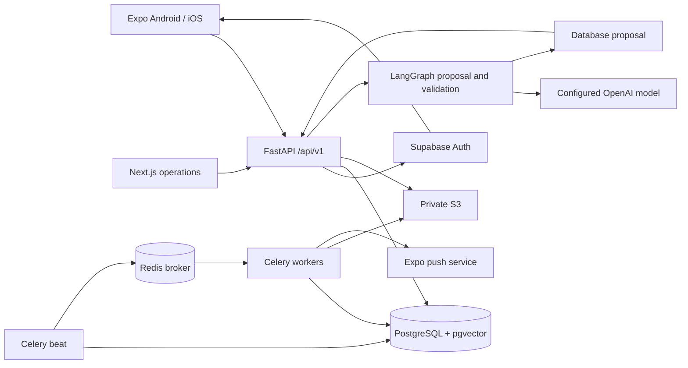

# Architecture

## Service boundaries

Expo owns presentation, form validation and device permissions. TanStack Query owns transient server state; Zustand holds the session/theme/device identity; SecureStore persists native Supabase sessions. SQLite caches only nonsensitive summary counts and sync timestamps. Web preview sessions stay in memory.

Supabase Auth owns passwords, email verification, recovery and token refresh. FastAPI verifies every bearer token through the managed `/auth/v1/user` endpoint and additionally requires verified email. It does not trust frontend identity, roles or editable user metadata. Admin role is stored in the application database. Local JWT authentication is explicitly development-only with issuer, audience, expiry and signature checks.

FastAPI owns object authorization, entitlements, validation, approval transitions and transactions. A dedicated PostgreSQL database stores application data and is not exposed through the Supabase Data API. Do not point this service at an exposed public schema without a separate RLS/privilege migration and review.

Celery beat polls PostgreSQL every 30 seconds. Due reminders are locked with `FOR UPDATE SKIP LOCKED` and converted into unique delivery rows and durable jobs in one transaction. The broker contains job IDs, not document content. Workers commit job claims before external effects. Failed safe operations retry up to four attempts. Ambiguous push outcomes or stale push claims are held for review rather than resent automatically. There is no claim of exactly-once delivery across the provider boundary.

Private S3 stores original documents. The API validates content signatures, size and parser limits, optionally scans through ClamAV, and creates extraction jobs. Metadata and extracted text live in separate tables. Authorized requests obtain 120-second attachment URLs. Local storage serves files through the authenticated API.

LangGraph produces structured proposals and validates their arguments. Approved actions execute through allowlisted services with fresh authorization and database row locks. Conversation transcripts are not workflow state. AI context is owner-scoped before it reaches the model. Extracted content is untrusted and cannot invoke tools directly.

The Next.js admin app calls aggregate APIs using the current session token. No private-document access is granted by the admin role. Configuration changes and operational reads are audited.

## Data flow

## Operational assumptions

PostgreSQL is the production target; SQLite supports local development and portable tests only. Database foreign keys own deletion cascades. Original-file deletion and external auth deletion are not distributed transactions; failed deletion jobs retain a blocked account and can be retried. Shared task contents are intentionally shared but private document links are rejected on shared tasks. Household owners require a verified Family entitlement to create/invite; access revocation is checked on each request.

## Boundaries still requiring work

Production malware scanning readiness, object-store lifecycle reconciliation, high-volume pagination/metrics, billing purchase/restore flows, complete translation coverage, provider integration tests and native-device QA remain release gates. Observability currently consists of structured request/error-type logs, request IDs, health/readiness endpoints and persisted audit/jobs. Sentry/OTel are not wired yet.
